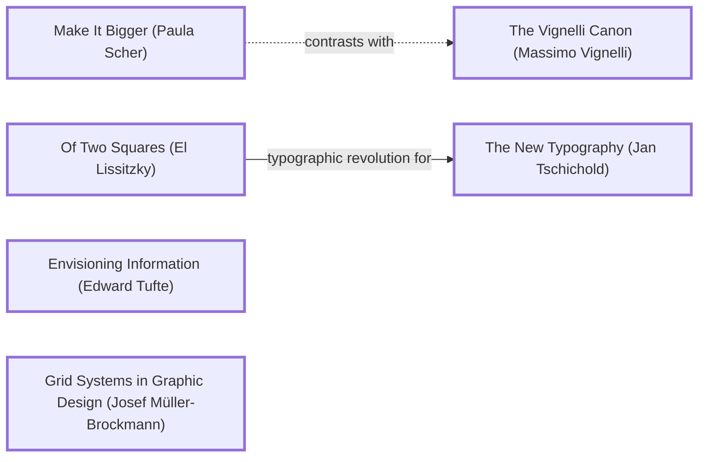

# MacroEconomics: DADA design log

Run started 2026-10-31. The pre-redesign state is on the branch `legacy-2026-10-30` (d4339fb), which already existed at that commit; a duplicate `legacy-2026-10-31` pushed by mistake was deleted. Lessons read before Step 1: `dada-lessons/LESSONS.md` (including lesson 40, from FoodChart's B grade) and `GRADES.md`.

## 1. Traversal Plan

**Brief, restated.** Turn MacroEconomics, a repo of twelve loose data files about oil, inflation, ports, the CFA franc, funding and crypto strategies (three of which do not parse) with no page, into a reorganized, multi-page, deploy-ready static site that repairs the data openly and leads with one bold graphic that is complete on the first screen.

**Mode: Adaptive.** The site serves a public (students, journalists, people living under the CFA franc, newcomers). Governing criterion: MAYA, Most Advanced Yet Acceptable (Loewy).

**Run type: Full.** A redesign; nothing frozen.

**Carried in from the last run's grade (B).** The First screen rule: the landing's signature graphic is measured complete (bottom edge above the fold, no sideways scroll) at 1280 x 800 and 375 x 812, and the landing leads with a bold graphic, not a headline. A Formalist seat (Arnheim) sits on the panel to judge visual force.

**Tooling inventory.**
| Job | Tool used |
|---|---|
| Render and navigate the anchor graph | none available as a renderer; Mermaid text here, labels grepped from `references/anchor-graph.md` |
| Compute the Frontier | by hand from the graph's edge lines |
| Track workflow state | the app's task list plus this log |
| Run the panel | Agent tool, one agent per reference, at most three at a time, each filing to `panel/<round>/<seat>.md` |
| Collect panel reports | listing `panel/<round>/` |
| Measure the artifact | the in-app browser (geometry, computed styles, contrast) and Python on the data |
| Persist the log | this file |

**Seed (labels copied from the graph).**
- Stance: `Make It Bigger (Paula Scher)`: answers the B grade directly; the landing graphic is the page.
- Rules: `Envisioning Information (Edward Tufte)` and `Grid Systems in Graphic Design (Josef Müller-Brockmann)`.
- Breaker: `Of Two Squares (El Lissitzky)`: constructivist red and black, heavy bars as the argument; edge `lissitzky -->|typographic revolution for| The New Typography (Jan Tschichold)`.
- Counterpoint (dotted): `The Vignelli Canon (Massimo Vignelli)`, via `scher -.->|contrasts with| vignelliCanon`: discipline against bigness.

**Panel (Adaptive, 7 seats, one agent per reference).** Critic: Provocateur (Debord), Critic: Provocateur (Shklovsky), Critic: Inclusion (Holmes), Critic: Inclusion (Mace), Critic: Usability (Krug), Critic: Evidence (Cairo), Critic: Formalist (Arnheim). Dotted pair: `crit_prov_debord -.->|attacks smoothness favored by| crit_use_krug`.

**Bound.** At most 3 WHOLE rounds after R0; at most 3 ADAPT rounds on a move. Open items after that are logged, not chased. Disk: work on D: (NTFS, 56 GB free); E: filled during the last run.

## Premortem, round R0 (the inherited repo)

### Panel, WHOLE, round R0 (artifact examined: commit d4339fb; `panel/R0/EVIDENCE.md`)
| Critic | Anchor used | Observed in the work | Verdict | Requested change |
|---|---|---|---|---|
| Provocateur (Debord) | spectacle; détournement | Venezuela 304,000 / 302,809 / 300,900; a "benefit" filed under CFA Criticism; "Steadier returns over time"; a straight line sold as "Predicted Future Prices" | OBJECT | Show every number with source and dispute; set each claimed benefit beside its cost; correct, adjustable QF calculator; the landing shows a contradiction, not a flattering summary |
| Provocateur (Shklovsky) | ostranenie | data pre-automatized; plan risks the stock fintech dashboard | OBJECT | Landing makes one familiar quantity strange (three oil figures that will not reconcile); inflation as purchasing power decaying, not a line; QF matches shifting live |
| Formalist (Arnheim) | balance, visual weight, the cut-off shape | only the oil data gives a whole silhouette; gaps and long lists give ragged, cut-off forms | OBJECT (to a line, map or multi-series hero) | One horizontal bar chart as a single stepped wedge, longest on top, one saturated colour for one group, full width, complete at 390 px with no scroll; inline SVG |
| Evidence (Cairo) | How Charts Lie | measured: inflation 18 of ~190 economies, 4 rows complete, peaks 4,145% (Angola 1996); reserve sources differ up to 3,795% (Canada: OPEC 4,421 vs EIA 170,000); ports 300 rows, 287 unique, ranks to 370 | OBJECT | Chart only what can be vouched for; reserves as a range across sources; ports as two methods side by side; inflation with labelled gaps and a clipped or log axis; every chart states units, source, date, n and exclusions |
| Inclusion (Holmes) | Mismatch | no page; one-sided CFA account; unsafe crypto frame; a wrong formula | OBJECT | Table twin and plain takeaway per chart; "what this is, in plain words" per page; French on the CFA page; sources side by side; risk statement; light pages, data downloads |
| Inclusion (Mace) | Perceptible information | nothing perceivable; units unknown | OBJECT | Landmarks, one h1, skip link; 3 px focus ring ≥3:1; charts as role=img with a finding, plus real tables; calculator with labelled native inputs, live region, worked example, no-JS table; 44 px targets, 320 px reflow, dark theme |
| Usability (Krug) | trunk test | no README; the topics share no obvious subject; "funding public goods" and "allocation strategies" are insider terms | OBJECT | Site name and tagline in every header; one flat nav of 7 plain labels, current page marked; landing: chart with a caption saying what to notice, then topic cards grouped under 2 or 3 headings, each with the question it answers; every H1 a question or claim; footer repeats the nav |

Andon pulled: no.

**Rival pair at R0 (lesson: merges, not compromises).** Arnheim wants one clean, ranked wedge; Debord and Shklovsky want a contradiction, not a ranking; Cairo wants the dispute shown as a range. Merge (M3): one heavy bar per country for the US EIA figure, ranked as a single stepped wedge, with OPEC and BP as hairline ticks on each bar, so the silhouette is whole and the dispute is visible in the same shape; Canada's OPEC tick near zero is the contradiction the eye finds.

## Frontier
| Candidate | Reached via | From anchor | Status |
|---|---|---|---|
| F1 Repair the data openly; one clean file per topic; raw kept | R0 Cairo, Debord, Holmes, Mace | How Charts Lie (Alberto Cairo) | TAKEN (M1) |
| F2 A design system with visual force | R0 Arnheim; seed | Of Two Squares (El Lissitzky) | TAKEN (M2) |
| F3 The landing graphic: the reserve dispute as one bold wedge, complete on the first screen | R0 Arnheim, Debord, Shklovsky, Cairo; First screen rule | Make It Bigger (Paula Scher) | TAKEN (M3) |
| F4 Page structure, plain-words openings, source line and table twin per chart | R0 Krug, Holmes, Mace | Don't Make Me Think (Steve Krug) | TAKEN (M4) |
| F5 Inflation as purchasing power, gaps shown | R0 Shklovsky, Cairo | Art as Technique (Viktor Shklovsky) | TAKEN (M5) |
| F6 Ports: two ranking methods side by side | R0 Cairo | Envisioning Information (Edward Tufte) | TAKEN (M6) |
| F7 CFA franc: the peg made strange; benefit beside criticism; French summary | R0 Debord, Holmes, Shklovsky | The Society of the Spectacle (Guy Debord) | TAKEN (M7) |
| F8 Correct, accessible quadratic funding calculator | R0 Debord, Shklovsky, Mace, Holmes | The Principles of Universal Design (Ronald Mace et al.) | TAKEN (M8) |
| F9 Strategies: each claimed benefit beside how it loses; risk statement | R0 Debord, Holmes | The Society of the Spectacle (Guy Debord) | TAKEN (M9) |
| F10 Price prediction script | R0 Debord, Cairo | How Charts Lie (Alberto Cairo) | TAKEN (M1: kept in `_src/raw/`, not published; named on the data page) |
| F11 Complete World Bank inflation for all economies; ports beyond row 300 | R0 Cairo | How Charts Lie (Alberto Cairo) | DEFERRED (needs a download from the World Bank, which this run did not make; the gap is printed) |
| F12 Dotted counterpoint: Vignelli's discipline against Scher's bigness | seed | The Vignelli Canon (Massimo Vignelli) | TAKEN (M2: one typeface family, a fixed grid, one accent) |

## 2. Decision Records

## Move M1: Repair the data openly  (KEEP-THE-RULE)
Depends on: none
Anchors: Rule Envisioning Information (Edward Tufte) | Counterpoint How Charts Lie (Alberto Cairo)
Intent: keep every inherited file unchanged in `_src/raw/`; `_src/clean.py` reads them (leniently where they do not parse) and writes one clean JSON per topic to `_src/data/`, plus `repairs.json` listing every repair: comment lines and missing commas removed from the inflation file; the oil file's two structures merged with units stated, unitless fields dropped, years-of-reserves recomputed; 13 duplicate port rows removed (287 of an index of 370); the CFA "benefit" moved out of Criticism; the quadratic funding formula corrected; the price-prediction script kept but not published.
Formal argument: nothing can be charted honestly from files that do not parse or state units (R0 Cairo, Mace); keeping the raw files makes every repair checkable (Debord).
Alternatives rejected: (a) hand-edit the raw files: the inherited state is lost and repairs are invisible; (b) download fresh World Bank data: a download not asked for, and it would replace rather than repair (F11).
Consequence: the site publishes partial datasets and says so.
Fence: none broken.
Frontier effect: F3 to F9 become buildable.
Mode field: Advanced pole: a site that shows its own repairs. Acceptable pole: one JSON file per topic, downloadable.

## Move M2: Constructivist force, Vignelli's discipline  (BREAK)
Depends on: none
Anchors: Stance Make It Bigger (Paula Scher) | Breaker Of Two Squares (El Lissitzky) | Rule Grid Systems in Graphic Design (Josef Müller-Brockmann) | Counterpoint The Vignelli Canon (Massimo Vignelli) (dotted edge from Make It Bigger)
Intent: paper, black and one signal red. One family, Archivo, used across its width axis: condensed and black for headlines and bar labels, normal for text, tabular figures for numbers. Heavy rules and big bars carry the argument; red marks only the one group or finding a chart is about.
Formal argument: constructivism used scale and a single red to make an argument legible at a glance (Lissitzky); Vignelli's discipline (one family, a grid, few sizes) keeps the bigness from becoming noise.
Alternatives rejected: (a) a fintech dashboard of cards and gradients: the habit R0 Shklovsky named; (b) a newspaper markets page: dense tables with no single bold form, the B-grade failure.
Consequence: colour is scarce, so every chart needs direct labels as well as red (R0 Mace).
Fence: the grid exists so pages scan alike; every topic page uses the same chart frame (title as a claim, chart, source line, table twin).
Frontier effect: F3.
Mode field: Advanced pole: Lissitzky's red wedge. Acceptable pole: Vignelli's one-family discipline.

## Move M3: The landing graphic: three counters, one wedge  (BREAK)
Depends on: M1, M2
Anchors: Stance Make It Bigger (Paula Scher) | Breaker Of Two Squares (El Lissitzky) | Rule Envisioning Information (Edward Tufte)
Intent: the landing leads with one inline SVG: the ten largest proved reserves by the US EIA figure as heavy horizontal bars, longest on top (a single stepped wedge), OPEC members' bars in red with a direct label, and OPEC's and BP's figures as thin ticks across each bar. Canada's OPEC tick sits near zero. Title as a claim; units, sources, n and exclusions in one line under it. Measured complete in the first viewport at 1280 x 800 and 375 x 812 (bottom edge above the fold, no sideways scroll); a phone layout of the same bars, labels above each bar.
Formal argument: Arnheim's whole silhouette and Debord's visible contradiction in one shape; the First screen rule from the last grade.
Alternatives rejected: (a) the production snapshot as the hero (Arnheim's first pick): a clean ranking with no seam, which R0 Debord and Shklovsky reject; (b) Venezuela's three figures alone: strange but too small a subject for the page's one graphic.
Consequence: the hero is about reserves, not production; production moves to the oil page.
Fence: a ranked bar chart exists to compare one measure; here it compares one measure and marks two dissenting ones without re-ranking.
Frontier effect: none.
Mode field: Advanced pole: a ranking that shows its own dispute. Acceptable pole: a bar chart anyone can read.

## Move M4: Pages, openings and the chart frame  (KEEP-THE-RULE)
Depends on: M1, M2
Anchors: Rule Grid Systems in Graphic Design (Josef Müller-Brockmann) | Welcome Don't Make Me Think (Steve Krug) | Rule The Principles of Universal Design (Ronald Mace et al.)
Intent: nine pages: home, oil, inflation, ports, CFA franc, funding public goods (with the calculator), crypto strategies, about the data, 404. Navigation (ADAPTED to R0 Krug before the move was made): one flat nav of seven plain labels (Oil, Inflation, Ports, CFA franc, Funding public goods, Crypto strategies, About the data), the site name and a tagline in every header, and the grouping moved to the landing's topic cards (Energy and trade; Money and prices; Funding and investing), each card naming the question it answers. Each page opens with "In plain words" (two sentences); each chart has a title stating the finding, a source line (source, unit, date, n, exclusions), a role="img" label stating the finding, and a real table beside or under it.
Formal argument: the topics are loosely related; a grouped nav and a repeated frame make them scan alike (Krug, Müller-Brockmann); Mace's perceptible information.
Alternatives rejected: (a) one long page: the multi-page rule; (b) one page per dataset with no grouping: seven unrelated words in the nav.
Consequence: every chart needs a table, which roughly doubles page length below the fold.
Fence: none broken.
Frontier effect: Krug's R0 report may adjust the nav.
Mode field: Advanced pole: a repeated frame that makes a chart a claim with its evidence. Acceptable pole: plain words first.

## Move M5: Inflation as purchasing power  (BREAK)
Depends on: M1, M4
Anchors: Counterpoint Art as Technique (Viktor Shklovsky) | Rule Envisioning Information (Edward Tufte)
Intent: for the 4 rows with no missing years from 1960 (Australia, Austria, Belgium, Burkina Faso), what 100 units of money in 1960 buys in each later year, computed from the annual rates; then small multiples of all 18 rows, with gaps left as gaps, an axis clipped at 50% and an "off the scale" marker naming the peak.
Formal argument: a line of yearly percentages is automatized; purchasing power decaying from 100 is the same data made felt (Shklovsky); clipping with a named peak keeps three outliers from flattening everything (Cairo).
Alternatives rejected: (a) a log axis: honest but unreadable to newcomers; (b) chart all 18 as purchasing power: rows with gaps would be compounded through missing years.
Consequence: only four countries get the strong form; the page says why.
Fence: none broken.
Mode field: Advanced pole: money shrinking. Acceptable pole: "100 in 1960 buys this much".

## Move M6: Ports: two methods, one dumbbell  (KEEP-THE-RULE)
Depends on: M1, M4
Anchors: Rule Envisioning Information (Edward Tufte) | Counterpoint How Charts Lie (Alberto Cairo)
Intent: the top 30 ports by the administrative rank, each as a dumbbell from its administrative to its statistical rank; the ports that move 10 or more places named; the full 287-port table with both ranks.
Formal argument: two methods that mostly agree and sometimes disagree sharply are the finding; one rank would hide it (Cairo).
Alternatives rejected: (a) a ranked list only: hides the disagreement; (b) a map: no coordinates in the data.
Consequence: none.
Mode field: Advanced pole: a rank that admits its method. Acceptable pole: two dots and a line.

## Move M7: The CFA franc: the peg made strange  (BREAK)
Depends on: M1, M4
Anchors: Counterpoint The Society of the Spectacle (Guy Debord) | Counterpoint Art as Technique (Viktor Shklovsky)
Intent: the page leads with the peg set huge (€1 = F.CFA 655.957) and the fourteen countries under it in two zones; criticisms and claimed benefits in two columns side by side; the exchange-rate history as a step timeline; a French summary at the top ("En bref").
Formal argument: a number that governs fourteen countries is read as trivia (Shklovsky); a benefit filed as a criticism hides who claims it (Debord); the people concerned largely read French (Holmes).
Alternatives rejected: (a) a map: no geometry in the data; (b) English only: R0 Holmes.
Consequence: French text needs care; the summary restates only what the page says.
Fence: none broken.
Mode field: Advanced pole: the peg as the page's monument. Acceptable pole: two plain columns.

## Move M8: A correct quadratic funding calculator  (KEEP-THE-RULE)
Depends on: M1, M4
Anchors: Rule The Principles of Universal Design (Ronald Mace et al.) | Counterpoint The Society of the Spectacle (Guy Debord)
Intent: three projects, each with editable contributions (labelled number inputs), and a matching pool; the match for each project is (sum of square roots)^2 minus the sum, scaled so matches total the pool; results update live in an aria-live region as bars and numbers; a worked example computed at build is printed as a table, so the page works without scripts. The inherited formula is shown struck through, with the correction.
Formal argument: visitors act instead of watching (Debord); every input reachable by keyboard and announced (Mace).
Alternatives rejected: (a) sliders: drag-only for some users; (b) no calculator: the mechanism stays abstract.
Consequence: one small script; everything else stays static.
Mode field: Advanced pole: the formula you can push on. Acceptable pole: three boxes and a total.

## Move M9: Strategies: each benefit beside how it loses  (BREAK)
Depends on: M1, M4
Anchors: Counterpoint The Society of the Spectacle (Guy Debord) | Welcome Mismatch: How Inclusion Shapes Design (Kat Holmes)
Intent: the crypto strategies page opens with a risk statement ("not advice; crypto can lose all its value"); each strategy is a two-column row, the inherited "benefits" on one side and its inherited "risks" on the other, at equal weight; no returns are charted.
Formal argument: a benefit with no losing case is advertising (Debord); a reader under financial stress is the person to design for (Holmes).
Alternatives rejected: (a) drop the page: the inherited content has teaching value when framed; (b) add new claims about performance: unsourced.
Consequence: none.
Mode field: Advanced pole: the brochure turned into a ledger. Acceptable pole: two plain columns.

> Note: M2 to M9 were built in one pass after their records; three defects found while measuring were fixed before R1 and are listed in `panel/R1/EVIDENCE.md`: the phone landing failed the First screen rule (chart bottom y = 970 of 812, because the 7-link nav wrapped to three lines; fixed with a Menu button on phones and tighter rows: bottom 681), overlapping end labels on the inflation chart, and the dumbbell hiding equal ranks.

## 3. Panel Reports

### Panel, WHOLE, round R1  (artifact examined: site/ after M1 to M9; `panel/R1/EVIDENCE.md`, `home-1280.jpg`, `home-375.jpg`, `cfa-1280.jpg`)
All seven seats convened in batches of three, each filing to `panel/R1/`.
| Critic | Anchor used | Observed in the work | Verdict | Requested change |
|---|---|---|---|---|
| Formalist (Arnheim) | balance, weight, the cut-off shape | one stepped wedge, heaviest top-left; one contrast; Canada's black bar the point of tension; complete at both sizes (282 to 732 of 800; 252 to 681 of 812) | PASS | none (optional: longer ticks on phone) |
| Provocateur (Debord) | détournement | first image is a contradiction; benefit moved to Claimed benefits; live calculator; "How it loses" | PASS | none (residual: no measured cost of the peg) |
| Provocateur (Shklovsky) | ostranenie | disagreement is the form; 100 shrinking to 5.8; the peg monumental | PASS | none (optional: ports as waiting time; thicker ticks) |
| Inclusion (Holmes) | Mismatch | plain words, table twins, risk statement first, French summary | PASS | none (open: French for the criticisms block; sourced African voices) |
| Inclusion (Mace) | Perceptible information | **focus check: global `:focus-visible` 3 px, about 5:1 light, above 3:1 dark: PASS**; OPEC vs not carried by red vs black fill alone; legend keys aria-hidden; chart labels do not name OPEC members | OBJECT (one item) | Non-colour cue for OPEC on the bars and legend; name members in the aria-label; optional: Escape closes the Menu |
| Usability (Krug) | trunk test | name, tagline, nav, aria-current, claim H1, grouped cards all present | PASS | none (optional: plain label over the formula header; a "six topics below" cue) |
| Evidence (Cairo) | headline must not claim more than the data | every printed number recomputed: matches. But "agree almost everywhere" is false: 15 of 34 countries with two or more counts differ by more than 25% (top ten: Iran 34%, Russia 28%, Libya 63%, US 68%, Canada 3,795%). Ports: "55 of all 287" should be of 275 with both ranks; the "top 30" chart skips rank 24 and does not show Vung Tau | OBJECT | Reword the hero and oil takeaway; state the ports denominator and the chart's real n; say Vung Tau is off the chart |

Statements of meaning: one heavy shape says the oil is concentrated, one black bar says the counts disagree (Arnheim); each economic image with its seams and source (Debord); disagreement, decay and fixed numbers become the form (Shklovsky); a newcomer or a reader in financial stress can read and check the numbers (Holmes); the finding must reach a reader who cannot tell red from black (Mace); the visitor knows where they are (Krug); the numbers are right but two sentences claim more agreement and coverage than the data shows (Cairo).
Andon pulled: no.

**Resolutions.** Mace: premise checked in `site/index.html` (bars differ only by `fill`; legend keys `aria-hidden`): confirmed; ADAPT M3 (M10). Cairo: premise recounted from `_src/data/oil.json` (15 of 34 over 25%; 5 of the top ten) and `ports.json` (275 with both ranks): confirmed; ADAPT M3 and M6 (M10). Optional items taken in M10 where they cost one line (Holmes's French for the criticisms, Krug's formula label, the Escape key, thicker ticks); deferred: ports as waiting time (no waiting-time data in the file), sourced African voices and a measured cost of the peg (research). REOPENED: M3, M6, M7, M8.

## Move M10: The counts disagree; OPEC without colour  (KEEP-THE-RULE, adapts M3, M6, M7, M8)
Depends on: M3, M6, M7, M8
Anchors: Rule The Principles of Universal Design (Ronald Mace et al.) | Counterpoint How Charts Lie (Alberto Cairo) | Breaker Of Two Squares (El Lissitzky)
Intent: (1) the hero and oil takeaways say the counts disagree, computed at build: Canada the extreme, and how many of the ten differ by a quarter or more; (2) OPEC bars carry a diagonal hatch as well as red, the legend key matches, the aria-label names the OPEC members; (3) ports: "of the N ports with both ranks", the dumbbell caption gives its real count and the admin ranks it skips, and names the largest mover as off the chart; (4) French for the criticisms and claimed benefits; (5) the funding table's formula header gains a plain label; (6) Escape closes the phone Menu and returns focus to the button; (7) ticks 4 px.
Formal argument: a title is an argument and must not claim more than the data (Cairo); one finding carried by hue alone fails perceptible information (Mace); the hatch keeps Lissitzky's single red but adds a second, colour-independent channel.
Alternatives rejected: (a) recolour non-OPEC bars grey: weaker contrast against paper, and still colour-only; (b) drop "almost everywhere" and say nothing: loses the finding that most counts are close.
Consequence: the hero sentence is longer by a clause; must still pass the First screen rule (re-measure).
Fence: the red exists to mark the one group a chart is about; it still does.
Frontier effect: none.
Mode field: Advanced pole: a headline that counts its own disagreement. Acceptable pole: a pattern anyone can see.

### Panel, WHOLE, round R2  (artifact examined: site/ after M10; `panel/R2/EVIDENCE.md`, `hero-hatch-1280.png`)
All seven seats convened, filing to `panel/R2/`.
| Critic | Anchor used | Observed in the work | Verdict | Requested change |
|---|---|---|---|---|
| Formalist (Arnheim) | weight; texture as subordinate modulation | hatch reads as surface, the wedge stays one red mass; black exceptions stronger; complete at both sizes | PASS | none |
| Provocateur (Debord) | détournement | the image states its own disagreement rate; ports admits what it leaves out | PASS | none (residual: who benefits from each count; no measured cost of the peg) |
| Provocateur (Shklovsky) | ostranenie | hatched against solid, 170 against 4.4 | PASS | none |
| Inclusion (Holmes) | Mismatch | French on every criticism and benefit, idiomatic | PASS | none (open: French for Reform; larger French labels; sourced African voices) |
| Inclusion (Mace) | Perceptible information | hatch, hatched legend key, members named in reserves labels; **focus check: PASS**; the production chart's label does not name OPEC members and its source line says "in red" (the R2 evidence file wrongly claimed it did) | PASS | none (optional: name members on the production chart) |
| Usability (Krug) | trunk test | trunk intact; claims scannable | PASS | none (optional: "Four others" in words) |
| Evidence (Cairo) | headline must not claim more than the data | every changed sentence recomputed: 4, 34/15, 275/55, Vung Tau, 30 shown and rank 24 absent: all match | PASS | none (optional: state the base of "differ by more than 25%") |

Andon pulled: no. **S2 met at R2.** No ADAPT, SCRAP or REOPEN; optional items enter M11. The evidence file's claim about the production chart was wrong; it was a claim about the artifact made without measuring it, and is corrected by M11.

## Move M11: Optional items from R2  (KEEP-THE-RULE)
Depends on: M10
Anchors: Rule The Principles of Universal Design (Ronald Mace et al.) | Counterpoint How Charts Lie (Alberto Cairo) | Welcome Mismatch: How Inclusion Shapes Design (Kat Holmes)
Intent: the production chart names its OPEC members in its label and says "hatched" in its source line; "differ by more than 25%" becomes "the highest count is more than 25% above the lowest"; the Reform paragraph gains a French version; French lines and labels move from muted italic 0.92em / 0.75em to ink at 1em and 0.85em; "4 others" written as a word.
Formal argument: each is a claim the panel measured as weaker than it should be; none changes a device.
Alternatives rejected: (a) leave as open items: each costs one line; (b) translate the whole CFA page: beyond what the inherited text supports reviewing.
Consequence: none.
Mode field: Advanced pole: unchanged. Acceptable pole: clearer wording and larger French.

## Move M12: The ambition push: 38 times  (BREAK, the S4 push on M3)
Depends on: M3, M10
Anchors: Breaker Of Two Squares (El Lissitzky) | Stance Make It Bigger (Paula Scher)
Intent: on the desktop landing chart, a large red figure "38×" in the right margin at Canada's row, with a small line under it, "EIA count ÷ OPEC count", computed at build; on the phone chart the same ratio added to Canada's red label. Measured before: the dispute is carried by a 15-character red label. After: a numeral at display size. Must still pass the First screen rule.
Formal argument: Lissitzky's red wedge drives into the field; Scher's bigness makes the one finding the page's loudest object after the wedge itself.
Alternatives rejected: (a) a full-screen "38×" hero with the chart below: breaks the First screen rule's graphic-first order; (b) range bars for every country: a second encoding that competes with the wedge.
Consequence: the margin is no longer empty; Arnheim's balance must be re-judged (R3).
Fence: the margin was empty to let the wedge breathe; the numeral sits in Canada's row only.
Mode field: Advanced pole: a number at poster scale. Acceptable pole: "EIA count ÷ OPEC count" printed under it.

### Panel, WHOLE, round R3  (artifact examined: site/ after M11 and M12; `panel/R3/EVIDENCE.md`, `home-1280-38x.jpg`)
All seven seats convened, filing to `panel/R3/`.
| Critic | Anchor used | Observed in the work | Verdict | Requested change |
|---|---|---|---|---|
| Formalist (Arnheim) | balance; vectors of the field | 38× sits in the wedge's empty corner as a counterweight, smaller than the wedge, clear of Canada's label; first screen whole | PASS | none |
| Provocateur (Debord) | the commodified number | 38× is loud but captioned with the two counts it divides; an audit, not a product | PASS | none (residual: it invites quotation alone) |
| Provocateur (Shklovsky) | ostranenie | a quiet discrepancy made a shock, computed and labelled | PASS | none |
| Inclusion (Holmes) | Mismatch | Reform in French at full size; 38× also in the phone label's text | PASS | none (open: French for the history section; named African economists) |
| Inclusion (Mace) | Perceptible information | production label names OPEC members; French at full size; **focus check: PASS**; but "38×" is SVG text inside role="img" and no accessible text states the ratio | OBJECT (small) | State the 38-times gap in the chart labels or the lede |
| Usability (Krug) | trunk test | a skimmer reads 38× as "one count is 38 times the other"; "Four others" in words | PASS | none |
| Evidence (Cairo) | a headline figure states its procedure | 38× = 170,000 ÷ 4,421 = 38.45; "Four"; 15 of 34; production members: all match | PASS | none (optional: say the definitions differ under the numeral) |

Andon pulled: no. **Mace's premise measured:** before the fix, 0 of the landing's aria-labels contained "38"; confirmed. Resolved by M13. R3 is the last WHOLE round under the run's bound, so M13 was not panelled again.

## Move M13: The ratio in words  (KEEP-THE-RULE, after R3)
> Made after the final round, on Mace's R3 objection and Cairo's R3 option; recorded before the edit, not re-panelled (round bound reached).
Depends on: M12
Anchors: Rule The Principles of Universal Design (Ronald Mace et al.) | Counterpoint How Charts Lie (Alberto Cairo)
Intent: both landing-chart labels (wide and phone) say "the EIA's count is 38 times OPEC's (the two define oil differently)"; the note under the numeral reads "EIA count ÷ OPEC count; definitions differ".
Formal argument: the page's loudest finding must reach every reader as words (Mace); a ratio of two counts defined differently must say so where it is shown (Cairo).
Alternatives rejected: (a) put the ratio in the lede: it would wrap the lede to three lines and cost the First screen margin (measured before: 3 lines put the legend at 793 of 800); (b) aria-hidden the numeral: hides it without replacing it.
Consequence: the note is wider; measured: no overlap with any value label; First screen unchanged (732 / 764 of 800; 703 / 790 of 812).
Residual diff: aria-labels mentioning the ratio 0 → 2; note text extended; no layout change.
Mode field: Advanced pole: unchanged. Acceptable pole: the finding in a sentence.

## 2f. Deletion review and residual diffs

Elements that predate the run, and what each earns:
| Element | Earns | Decision |
|---|---|---|
| The twelve raw files at the repo root | the content, and the evidence of what was repaired | KEPT, unchanged, moved to `_src/raw/` (the repo root holds only the static format); none published as-is |
| `HistoricInflationDataSchema.json` (0 bytes) | nothing | KEPT in `_src/raw/` only so the repair list can name it; not published. Retained value: none |
| `PricePrediction.py` | nothing as a forecast (fits a line to a file that is not there) | KEPT in `_src/raw/`, not published; named on the data page |
| `OilReserves.json` fields `Other_Reserves`, `Production_2021` (OilData block) | nothing: no unit, no match to any other figure | SCRAPPED from the published data, listed in `repairs.json`. Retained value: the raw file still holds them |
| Stated "Years of Production in Reserve" | a static ratio that disagreed with its own inputs (US 6.3 stated, 10.7 computed) | SCRAPPED; recomputed at build |
| 13 duplicate port rows | nothing | SCRAPPED, listed |
| `LICENSE`, `CONTRIBUTING.md` | licence; contribution path | KEPT; the pointer to a missing README fixed |

Deletions inside the run, with residual diffs: M8 phone nav folded behind Menu (header 235 → 78 px, intended; full list without JS, intended); M10 "agree almost everywhere" deleted (intended; the replacement counts its own disagreement). No inert or regressed value found in the re-measurements above.

## 2g. Final-state figures (measured after the last edit, M13)

Procedure: `python _src/clean.py && python _src/build.py && python _src/check_figures.py`. The checker recomputes each figure from `_src/data/` and reads it back out of `site/*.html`.
36 checks, 0 mismatches: the landing's Canada figures (170 bn, 4.4 bn), "Four others", the 38× numeral, "41 countries", all ten bar labels; the oil page's 34 / 15, 3,795%, 39% OPEC share of production; four purchasing-power figures (5.8, 13.1, 11.7, 7.6); four off-scale inflation peaks (4,145%, 226%, 3,374%, 1,662%); ports 275 / 55, Vung Tau, 287 in file; CFA 14 countries, 193 million; the calculator example ($0, $750, $250). The social card draws its figures from the same data. No figure drifted; none corrected.

## Anchor Ledger
| Anchor | Role | Status | Evidence | Note |
|---|---|---|---|---|
| Make It Bigger (Paula Scher) | Stance | KEEP | the wedge fills the first screen; 38× at poster scale | survived R0 Arnheim (no bold graphic in the inheritance) and R3 Debord (the loud number as spectacle) |
| Of Two Squares (El Lissitzky) | Breaker | KEEP | one red, heavy bars, the red numeral | survived R1 Mace (red alone carries meaning): ADAPTED by the hatch (M10) |
| The Vignelli Canon (Massimo Vignelli) | Counterpoint (dotted from Scher) | KEEP | one family, one grid, one accent; the same chart frame on every page | |
| Envisioning Information (Edward Tufte) | Rule | KEEP | ticks for dissenting counts on one bar; dumbbells; small multiples | survived R0 Cairo (ragged data): gaps drawn as gaps |
| Grid Systems in Graphic Design (Josef Müller-Brockmann) | Rule | KEEP | repeated frame: claim, takeaway, chart, source, table twin | |
| The New Typography (Jan Tschichold) | Reached via lissitzky edge | KEEP | asymmetric, flush-left, condensed black headlines | |
| How Charts Lie (Alberto Cairo) | Counterpoint | KEEP | M1, M10, M13, 2g | |
| The Society of the Spectacle (Guy Debord) | Counterpoint | KEEP | M3, M7, M9 | |
| Art as Technique (Viktor Shklovsky) | Counterpoint | KEEP | M5, M7, M12 | |
| The Principles of Universal Design (Ronald Mace et al.) | Rule | KEEP | M8, M10, M13 | |
| Mismatch: How Inclusion Shapes Design (Kat Holmes) | Welcome | KEEP | M7, M9, M11 | |
| Don't Make Me Think (Steve Krug) | Welcome | KEEP | M4 | |
| Art and Visual Perception (Rudolf Arnheim) | Rules (via the Formalist seat) | KEEP | M3, M12 | |

Live graph: no renderer; final classes `class scher,lissitzky,vignelliCanon,tufteE,mb,newtypo kept`.

## Frontier (final)
TAKEN: F1 to F10, F12 (M1 to M9), R1 items (M10), R2 options (M11), S4 push (M12), R3 items (M13).
DEFERRED with reasons: F11 complete World Bank inflation and ports beyond row 287 (needs a download this run did not make); French for the CFA history section and named, sourced African economists on each side (Holmes R2, R3: research and translation review); a measured cost of the peg and who benefits from each oil count (Debord R1, R2: research); ports drawn as waiting time (Shklovsky R1: the data holds ranks, not times).
**No OPEN items.**

## 4. Stop test
- **S1 met.** No OPEN Frontier items.
- **S2 met at R2** (seven PASS, no Andon). Not re-met at R3: Mace objected (one item), resolved by M13 after the round, not re-panelled.
- **S3 NOT met.** R1 had two OBJECTs; R2 was quiet except optional items (taken in M11); R3 had one OBJECT. The run reached its bound of three WHOLE rounds. Logged as an open item under the user's rule that DADA must not loop.
- **S4 met.** M12 pushed M3: measured change, the dispute went from a 15-character red label to a 108 px numeral; First screen still whole (732 / 764 of 800). It survived R3 (Arnheim, Debord, Shklovsky, Krug, Cairo PASS; Mace's objection was about its accessibility, fixed by M13).
- **S5 met.** Dotted edges from used anchors: `scher -.->|contrasts with| vignelliCanon` applied (M2); `scher -.->|identity as environment answers| wheeler` declined: identity at environmental scale is not this site's problem; `crit_prov_debord -.->|attacks smoothness favored by| crit_use_krug` applied as the panel's dotted pair, and produced M10's wording.
- 2g run after the last edit (M13): 36 checks, 0 mismatches.

**Result: S1, S4, S5 met; S2 met at R2 but not re-met after M13; S3 not met (bounded stop).**

## 5. Double loop
The criterion held, and the carried-in First screen rule did its job: it caught a real failure (the phone chart ended at y = 970 of 812 because the nav wrapped) before any seat saw the page, which the FoodChart run had missed entirely. The panel worked better with the Formalist seat than without it: Arnheim set the hero's form at R0 and judged the push at R3, the role nobody held last time. Two failures of the process: I wrote one claim into an evidence file without measuring it (that the production chart named OPEC members; Mace caught it in R2), and the loudest element of the page, the 38× numeral, shipped without its finding in accessible text until R3. Both are the same mistake: asserting about the artifact instead of reading it back. **Graph amendments:** none to the graph. **Process amendment** (for the skill's panel section): an evidence file may state only what was measured after the last edit, with the reading that produced it; and every visual-only element added by a move (a numeral, a hatch, a colour) must have its finding checked in accessible text before the round, not after.

## 6. Compliance Check
- [x] Tooling inventory; tool for each job or "none available" (§1)
- [x] Mode stated with the reason: Adaptive (§1)
- [x] Seed with exact labels, one dotted-edge counterpoint, a living Frontier (§1, Frontier)
- [x] Run type stated: Full; nothing frozen
- [x] For a website: the landing leads with one bold graphic, measured complete at 1280 x 800 (chart bottom 732, legend 764) and 375 x 812 (703, 790), no sideways scroll
- [x] BREAK moves taken: M2, M3, M5, M7, M9, M12; no quota used as a stopping rule
- [~] Decision Record before each move: yes for M1 to M13; M2 to M9 were built in one pass after their records were written, and three defects found while measuring were fixed before R1 (listed in the R1 evidence)
- [x] Panel Report per round, mode composition met (7 seats, one agent per reference, dotted pair Debord–Krug), every critic citing something observable (R0 to R3)
- [x] Every OBJECT resolved: R0 into moves; R1 Mace and Cairo ADAPT (M10); R3 Mace ADAPT (M13); dependents reopened
- [~] WHOLE rounds run; S1, S4, S5 met; S2 met at R2; S3 not met (bounded)
- [x] Every displayed figure re-measured at the final state, with the procedure (`_src/check_figures.py`, 36 checks, 0 mismatches)
- [x] Anchor Ledger complete; graph classes recorded as text (no renderer)
- [x] Double-loop paragraph written
- [ ] Final reply states mode, tools, stop conditions and everything skipped (in the reply)
